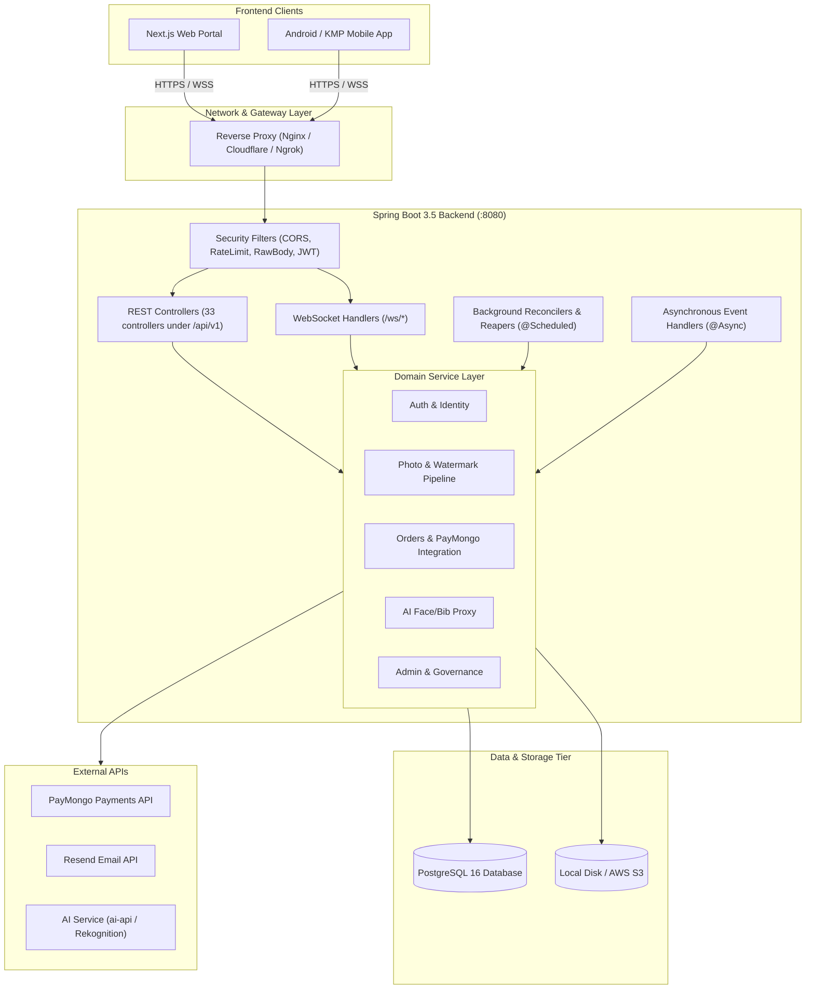
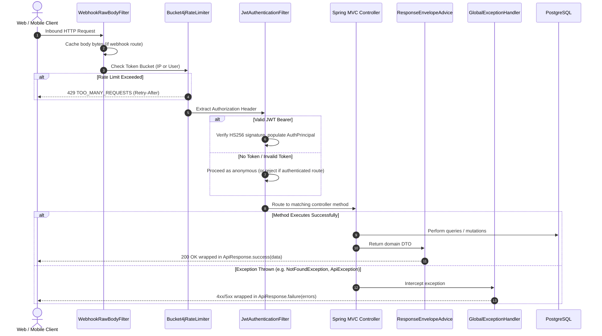
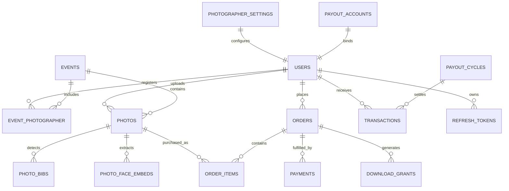
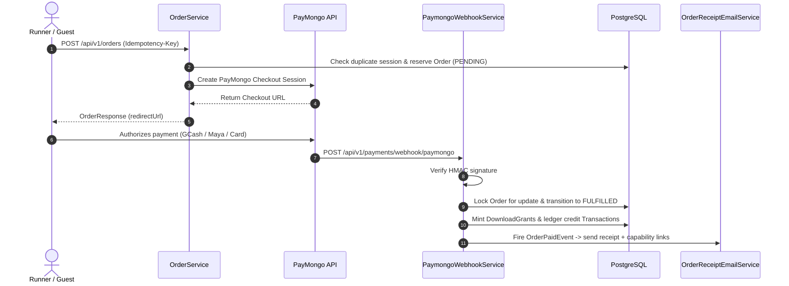
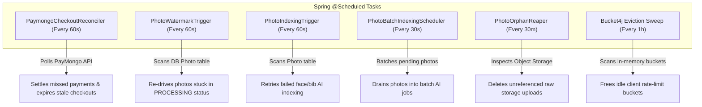

# QuickPitik Backend: Comprehensive Architecture & System Design

**Document Version:** 1.0.0  
**Generated Date:** September 4, 2026  
**Target Service:** `backend` (Spring Boot 3.5.14 / Kotlin 1.9.25 / JDK 21)  
**Corpus / Context:** Event Photography Marketplace (Sports / Marathons)  

---

## Table of Contents
1. [Executive Summary & System Context](#1-executive-summary--system-context)
2. [Technology Stack & Runtime Environment](#2-technology-stack--runtime-environment)
3. [High-Level Architecture & Topology](#3-high-level-architecture--topology)
4. [Request Lifecycle & Cross-Cutting Infrastructure](#4-request-lifecycle--cross-cutting-infrastructure)
5. [Database Architecture & Data Model](#5-database-architecture--data-model)
6. [Security & Identity Architecture](#6-security--identity-architecture)
7. [Core Subsystems & Pipelines](#7-core-subsystems--pipelines)
   - [7.1. Authentication & Identity Management](#71-authentication--identity-management)
   - [7.2. Event Management & Fair Gallery Delivery](#72-event-management--fair-gallery-delivery)
   - [7.3. Photo Ingestion & Watermarking Pipeline](#73-photo-ingestion--watermarking-pipeline)
   - [7.4. AI Face Indexing & Bib OCR Pipeline](#74-ai-face-indexing--bib-ocr-pipeline)
   - [7.5. E-Commerce, PayMongo Payments & Fulfillment](#75-e-commerce-paymongo-payments--fulfillment)
   - [7.6. Financial Ledger, Earnings & Payouts](#76-financial-ledger-earnings--payouts)
   - [7.7. Admin Operations & Governance](#77-admin-operations--governance)
8. [Real-Time WebSocket Architecture](#8-real-time-websocket-architecture)
9. [Background Schedulers & Self-Healing Reconcilers](#9-background-schedulers--self-healing-reconcilers)
10. [Environment Variables & Configuration Reference](#10-environment-variables--configuration-reference)
11. [Package & Symbol Navigation](#11-package--symbol-navigation)

---

## 1. Executive Summary & System Context

**QuickPitik** is a specialized, multi-sided event photography platform tailored for sports and athletic events (such as marathons, triathlons, and fun runs) in the Philippines.

The system serves three primary user personas:
1. **Runners / Athletes:** Discover photos via bib number OCR search or selfie facial recognition; purchase high-resolution unwatermarked photos via Philippine payment rails (GCash, Maya, cards); download single photos or streamed ZIP bundles.
2. **Photographers:** Register coverage for events; upload raw high-resolution captures in bulk; configure custom watermarks, logos, and coupon promotions; track earnings and request payouts.
3. **Platform Administrators:** Review and approve events; audit photographer verifications; arbitrate customer disputes; monitor financial health and manage payout cycles.

The **Spring Boot Backend** acts as the authoritative core for the entire ecosystem. Both the Next.js web application and the Android/KMP mobile application communicate strictly with this backend. The backend encapsulates business rules, arbitrates database persistence, coordinates asynchronous media pipelines, safeguards financial transactions, and securely proxies AI inference calls.

---

## 2. Technology Stack & Runtime Environment

| Concern | Selection | Architectural Justification |
|---|---|---|
| **Language** | Kotlin 1.9.25 | Null safety, concise data classes, clean functional idioms, and full Java interoperability. |
| **Runtime** | OpenJDK 21 | Modern LTS JVM supporting virtual threads and performance optimizations. |
| **Framework** | Spring Boot 3.5.14 | Comprehensive enterprise ecosystem (Spring Web, Spring Security, Spring Data JPA, WebSockets). |
| **Database** | PostgreSQL 16 | Relational consistency, JSONB support, transactional integrity, partial indices. |
| **Schema Migration** | Flyway Core 10 | 46 reproducible, linear SQL migrations ([db/migration/](file:///c:/Users/USER/Documents/School/4th%20Year%201st%20Semester/Capstone%20and%20Research%202/CAPSTONE%20PROJECT/Capstone-Project/backend/src/main/resources/db/migration)). |
| **Auth & Security** | JJWT (0.12.6) + Nimbus JOSE | Stateless HMAC-SHA256 JWT access tokens, SHA-256 opaque refresh tokens, and Google JWKS verification. |
| **Rate Limiting** | Bucket4j 8.10.1 | In-memory token bucket algorithms guarding sensitive routes from credential stuffing and DoS. |
| **Object Storage** | Pluggable (Local FS / AWS S3) | Seamless switching between local filesystem for development and AWS S3 for production. |
| **Image Processing** | Java2D + Metadata Extractor | Dynamic watermarking, EXIF orientation rotation, and DCT-based 64-bit perceptual hashing. |
| **AI Inference** | Pluggable (`ai-api` or Rekognition) | Self-hosted PyTorch/FastAPI engine or managed AWS Rekognition with event-isolated collections. |
| **Payment Gateway** | PayMongo API v1 | Philippine payment infrastructure supporting GCash, Maya, cards, and webhooks. |
| **Email Service** | Resend API | Transactional emails (receipts, password reset OTPs, verification links). |

---

## 3. High-Level Architecture & Topology



---

## 4. Request Lifecycle & Cross-Cutting Infrastructure

Every inbound HTTP request undergoes a standardized sequence of filter evaluations, controller execution, response envelope wrapping, and error interception.



### Key Infrastructure Classes

1. **[WebhookRawBodyFilter.kt](file:///c:/Users/USER/Documents/School/4th%20Year%201st%20Semester/Capstone%20and%20Research%202/CAPSTONE%20PROJECT/Capstone-Project/backend/src/main/kotlin/com/quickpitik/security/WebhookRawBodyFilter.kt)**  
   Wraps the `HttpServletRequest` in a caching wrapper for webhook paths (`/api/v1/payments/webhook/**`, `/api/v1/internal/ai-webhooks`). This allows constant-time cryptographic HMAC verification of the raw payload without consuming the request stream before controller binding.

2. **[Bucket4jRateLimiter.kt](file:///c:/Users/USER/Documents/School/4th%20Year%201st%20Semester/Capstone%20and%20Research%202/CAPSTONE%20PROJECT/Capstone-Project/backend/src/main/kotlin/com/quickpitik/service/ratelimit/Bucket4jRateLimiter.kt)**  
   Applies in-memory token bucket rate limiting. Protected scopes:
   - `auth-login`, `auth-register`, `auth-forgot-password`: 10 requests / 15 min per IP.
   - `photo-search`: 30 requests / 15 min per IP (protects expensive AI inference).
   - `photographer-upload`: 600 requests / 1 min per user.
   - `order-create`: 10 requests / 1 min per IP/user (bounds PayMongo session creation).
   - `photo-verify`: 10 requests / 15 min per IP (bounds CPU-heavy perceptual hash matching).

3. **[JwtAuthenticationFilter.kt](file:///c:/Users/USER/Documents/School/4th%20Year%201st%20Semester/Capstone%20and%20Research%202/CAPSTONE%20PROJECT/Capstone-Project/backend/src/main/kotlin/com/quickpitik/security/JwtAuthenticationFilter.kt)**  
   Parses `Bearer <token>`, extracts claims (`sub=userId`, `email`, `role`), and registers an [AuthPrincipal](file:///c:/Users/USER/Documents/School/4th%20Year%201st%20Semester/Capstone%20and%20Research%202/CAPSTONE%20PROJECT/Capstone-Project/backend/src/main/kotlin/com/quickpitik/security/AuthPrincipal.kt) in Spring's `SecurityContext`.

4. **[ResponseEnvelopeAdvice.kt](file:///c:/Users/USER/Documents/School/4th%20Year%201st%20Semester/Capstone%20and%20Research%202/CAPSTONE%20PROJECT/Capstone-Project/backend/src/main/kotlin/com/quickpitik/common/ResponseEnvelopeAdvice.kt)**  
   A Spring `ResponseBodyAdvice` interceptor that automatically wraps any controller return value into an `ApiResponse<T>`:
   ```json
   {
     "success": true,
     "data": { ... },
     "errors": null
   }
   ```

5. **[GlobalExceptionHandler.kt](file:///c:/Users/USER/Documents/School/4th%20Year%201st%20Semester/Capstone%20and%20Research%202/CAPSTONE%20PROJECT/Capstone-Project/backend/src/main/kotlin/com/quickpitik/exception/GlobalExceptionHandler.kt)**  
   Converts all handled and unhandled exceptions into the standard `ApiResponse` failure structure:
   ```json
   {
     "success": false,
     "data": null,
     "errors": [
       {
         "code": "ACCOUNT_LOCKED",
         "message": "Account is temporarily locked. Please try again in 15 minutes.",
         "field": null
       }
     ]
   }
   ```

---

## 5. Database Architecture & Data Model

The persistence layer uses **Spring Data JPA** over **PostgreSQL 16**. Schema evolution is managed via **Flyway** with 46 incremental migrations (`V1` through `V46`).

### Core Entity Relationships



### Key Performance & Modeling Strategies
- **Collection Batch Fetching:** `application.yml` sets `hibernate.default_batch_fetch_size: 50`. This prevents N+1 query fan-out when loading collections (such as `Photo.bibs` or `Photo.facePersons`), collapsing hundreds of child queries into single `WHERE parent_id IN (...)` queries.
- **Enterprise Deduplication Index:** A partial unique index (`uq_photos_photographer_content_hash`) on `(photographer_id, content_hash)` prevents the same binary photo from being uploaded twice by the same photographer.
- **Fair Ordering:** V44 migration implements randomized discovery order using deterministic seed-based ordering, ensuring all participating photographers receive balanced impressions.

---

## 6. Security & Identity Architecture

### A. Authentication & Session Management
- **Stateless Access Tokens:** Short-lived (15 minutes) HMAC-SHA256 JWTs containing `userId`, `email`, and `role`.
- **Rotated Refresh Tokens:** 32-byte cryptographically secure random base64url strings. The database stores only the SHA-256 hash. When a refresh occurs, the existing token is revoked and a new one is issued.
- **NIST SP 800-63B Password Validation:** Implemented in [PasswordValidator.kt](file:///c:/Users/USER/Documents/School/4th%20Year%201st%20Semester/Capstone%20and%20Research%202/CAPSTONE%20PROJECT/Capstone-Project/backend/src/main/kotlin/com/quickpitik/service/PasswordValidator.kt). Enforces an 8-character floor and screens against a curated dictionary of common and leaked passwords.
- **Account Lockout:** [LoginAttemptService.kt](file:///c:/Users/USER/Documents/School/4th%20Year%201st%20Semester/Capstone%20and%20Research%202/CAPSTONE%20PROJECT/Capstone-Project/backend/src/main/kotlin/com/quickpitik/service/LoginAttemptService.kt) records failed attempts. 5 failed logins within 15 minutes locks the account for 15 minutes (`429 ACCOUNT_LOCKED`).

### B. Google SSO Integration
Implemented in [GoogleAuthService.kt](file:///c:/Users/USER/Documents/School/4th%20Year%201st%20Semester/Capstone%20and%20Research%202/CAPSTONE%20PROJECT/Capstone-Project/backend/src/main/kotlin/com/quickpitik/service/GoogleAuthService.kt):
- Validates the Google ID Token signature using Google's auto-rotating JWKS keys (`spring-security-oauth2-jose`).
- Matches the token's audience against `GOOGLE_CLIENT_ID`.
- Safe auto-linking: If the email already exists and is verified, it links `google_sub`. If an existing account was unverified, its password is rotated to an unguessable string to neutralize potential pre-registration squatting.

### C. Webhook Cryptographic Verification
- **PayMongo Webhooks:** [PaymongoSignatureVerifier.kt](file:///c:/Users/USER/Documents/School/4th%20Year%201st%20Semester/Capstone%20and%20Research%202/CAPSTONE%20PROJECT/Capstone-Project/backend/src/main/kotlin/com/quickpitik/security/PaymongoSignatureVerifier.kt) parses the `Paymongo-Signature` header (`t=<timestamp>,te=<test_sig>,li=<live_sig>`) and computes constant-time HMAC-SHA256 digests against the raw request body.
- **AI Webhooks:** [AiWebhookSignatureVerifier.kt](file:///c:/Users/USER/Documents/School/4th%20Year%201st%20Semester/Capstone%20and%20Research%202/CAPSTONE%20PROJECT/Capstone-Project/backend/src/main/kotlin/com/quickpitik/security/AiWebhookSignatureVerifier.kt) verifies internal job callbacks from `ai-api`.

---

## 7. Core Subsystems & Pipelines

### 7.1. Authentication & Identity Management
Managed by [AuthController.kt](file:///c:/Users/USER/Documents/School/4th%20Year%201st%20Semester/Capstone%20and%20Research%202/CAPSTONE%20PROJECT/Capstone-Project/backend/src/main/kotlin/com/quickpitik/controller/AuthController.kt) and [AuthService.kt](file:///c:/Users/USER/Documents/School/4th%20Year%201st%20Semester/Capstone%20and%20Research%202/CAPSTONE%20PROJECT/Capstone-Project/backend/src/main/kotlin/com/quickpitik/service/AuthService.kt):
- `POST /auth/register`: Signs up `RUNNER` or `PHOTOGRAPHER`. Mails an advisory verification link asynchronously.
- `POST /auth/login`: Validates credentials, checks account lockout state, resets attempt counters on success.
- `POST /auth/google`: Exchanges Google ID Token for QuickPitik access/refresh pair.
- `POST /auth/forgot-password`: Mails a 6-digit OTP code (10-minute validity).
- `POST /auth/verify-reset-otp`: Validates the 6-digit OTP and returns an opaque 15-minute `resetToken`.
- `POST /auth/reset-password`: Uses the `resetToken` to set a new password, revoking all existing sessions.

---

### 7.2. Event Management & Fair Gallery Delivery
Managed by [EventController.kt](file:///c:/Users/USER/Documents/School/4th%20Year%201st%20Semester/Capstone%20and%20Research%202/CAPSTONE%20PROJECT/Capstone-Project/backend/src/main/kotlin/com/quickpitik/controller/EventController.kt) and [EventPhotoController.kt](file:///c:/Users/USER/Documents/School/4th%20Year%201st%20Semester/Capstone%20and%20Research%202/CAPSTONE%20PROJECT/Capstone-Project/backend/src/main/kotlin/com/quickpitik/controller/EventPhotoController.kt):
- Events encapsulate location metadata, dates, organizer profiles, and pricing modes.
- Photographers register coverage for approved events before uploading photos.
- **Fair Gallery Presentation:** When browsing event photos, queries apply deterministic pagination seeds to rotate and interleave photos across all participating photographers.

---

### 7.3. Photo Ingestion & Watermarking Pipeline
Implemented in [PhotoUploadService.kt](file:///c:/Users/USER/Documents/School/4th%20Year%201st%20Semester/Capstone%20and%20Research%202/CAPSTONE%20PROJECT/Capstone-Project/backend/src/main/kotlin/com/quickpitik/service/photographer/PhotoUploadService.kt) and [WatermarkService.kt](file:///c:/Users/USER/Documents/School/4th%20Year%201st%20Semester/Capstone%20and%20Research%202/CAPSTONE%20PROJECT/Capstone-Project/backend/src/main/kotlin/com/quickpitik/service/photographer/WatermarkService.kt).

```mermaid
flowchart LR
    A["Multipart Upload (JPEG/PNG/WebP ≤ 25 MiB)"] --> B["ImagePixelGuard (Dimension Check)"]
    B --> C["SHA-256 Original Content Hash"]
    C --> D["Duplicate Check (Per-Photographer)"]
    D --> E["Store Raw Image to S3/Disk"]
    E --> F["Insert Photo Record (Status: PROCESSING)"]
    O["Direct begin: gates + durable intent"] --> P["Client PUT to owner-scoped staging slot"]
    P --> Q["Commit: immutable copy + server byte validation"]
    Q --> F

    subgraph AsyncWorker["Asynchronous Processing (Off Request Thread)"]
        F -.-> G["PhotoWatermarkTrigger"]
        G --> H["Read EXIF Orientation Tag & Auto-Rotate"]
        H --> I["Composite Watermark (Logo, Geometry, Credit)"]
        I --> J["Generate 64-bit Perceptual Hash (pHash)"]
        J --> K["Store Preview & Thumbnail -> Status: LIVE"]
        
        F -.-> L["PhotoIndexingTrigger"]
        L --> M["AI Face Embedding & Bib OCR"]
        M --> N["IndexingStatus: COMPLETED"]
    end
```



**Architectural Highlights:**
- **No Transaction Over I/O:** The multipart file write to S3/disk occurs outside any database transaction, preventing long I/O operations from starving the database connection pool.
- **Decompression Bomb Guard:** [ImagePixelGuard.kt](file:///c:/Users/USER/Documents/School/4th%20Year%201st%20Semester/Capstone%20and%20Research%202/CAPSTONE%20PROJECT/Capstone-Project/backend/src/main/kotlin/com/quickpitik/service/image/ImagePixelGuard.kt) reads file headers prior to full raster decoding, rejecting corrupt files or dimension bombs.
- **EXIF Auto-Orientation:** Uses `metadata-extractor` to check EXIF rotation tags (preventing mobile portrait photos from displaying rotated sideways).
- **Watermark Resistance:** Applies diagonal wordmark patterns, custom photographer logos, and seed-based geometry derived from `HMAC(seed, photoId)`.
- **Copyright Verification:** Computes 64-bit DCT perceptual hashes. `POST /public/photos/verify` allows runners or admins to upload screenshots or crops and find the original photographer using Hamming distance comparison (≤ 12 bits).

**Direct upload contract — mobile/website/backend:**

`POST /api/v1/me/photographer/events/{eventId}/photos/direct` returns `direct`,
`existing`, or `multipart`. Direct mode first reserves a durable, owner/event-scoped
intent, then issues an expiring PUT URL for a private staging key. Optional
`requestId` makes begin idempotent; optional `client=website` is rollout-gated.
The additive response fields expose signed upload headers and PUT/intent deadlines.
Existing native clients may omit both request fields and ignore the new response data.

`POST /api/v1/me/photographer/events/{eventId}/photos/direct/commit` accepts
`photoId`, `key`, `contentHash`, `contentType`, and optional positive `sizeBytes`.
Existing clients may omit size. A new commit checks object HEAD metadata against
the persisted reservation, snapshots staging to the final original with a
source-ETag and create-only destination condition, then reads at most 25 MiB + 1
from that immutable original. The backend computes SHA-256, identifies the actual
JPEG/PNG/WebP format, checks dimensions and performs a bounded decode before any
photo row, counter or processing event is committed. Multipart upload uses the
same byte validator. The current JDK has no WebP ImageIO reader, so WebP fails
closed with 415 before direct issuance; no codec dependency is silently added.

A repeated committed intent must match owner, event, issued key and recorded
metadata. It returns the existing photo even after its event upload window closes
and never rewrites or deletes its original. Verification is protected by a bounded
semaphore plus a database lease token; photo insertion, both counters, processing
events and intent completion commit atomically. Photo-ID and photographer/hash
constraint races resolve only after rollback. Concurrent same-event duplicates
return the winner without extra counters/events; cross-event dedup remains a
terminal conflict. Unissued or foreign staging keys are never read or deleted.
Duplicate receipts and preflight results include `inTrash` when the existing
photo is trashed or being purged; the hash remains reserved and re-uploading
never restores, unhides or republishes it.

The per-photographer reservation quota (`STORAGE_DIRECT_UPLOAD_MAX_PENDING_PER_USER`,
bytes cap beside it) counts only reservations whose signed PUT is still open or
that are being verified; an abandoned reservation stays committable for 24 hours
but stops holding a slot when its PUT expires. A begin without `requestId` (the
Android worker) reuses that photographer's open `PENDING` reservation for the same
event and bytes when at least five minutes of PUT lifetime remain, so a retry
after a failed PUT takes no new slot. Two concurrent begins without `requestId`
for the same bytes may both reserve (no lock; the quota bounds it), and
`qp.upload.direct{outcome=begun}` counts a reuse as another grant.

`PhotoUploadCleanupTrigger` runs bounded fixed-delay sweeps without holding a
database connection across storage I/O. It expires abandoned intents, claims due
terminal receipts, removes staging and only deletes an original after checking
that no `Photo.s3Key` references it. Successful deletes are rechecked at doubling
intervals (1 h, 2 h, 4 h …) for seven days to catch late PUT/copy completion;
terminal receipts are retained. Permanent
photo deletion nulls the result FK and reschedules that receipt in the same short
transaction, so later commit retries remain terminal `PHOTO_NOT_FOUND` and cannot
recreate the photo. Cleanup is idempotent and a failed object is retried without
rolling back a committed photo.

Operational metrics are `qp.upload.direct{outcome=begun|committed|existing|rejected|expired}`,
`qp.upload.validation.duration`, `qp.upload.cleanup{outcome=cleaned|protected|complete|partial|failed}`,
and the gauges `qp.upload.direct.pending.count`, `qp.upload.direct.pending.bytes`,
and `qp.upload.direct.pending.oldest.age`. Labels never contain file, hash, URL,
or intent identifiers; cleanup logs contain only operation, intent ID and error class.

**R2 bucket rules (applied to production 2026-09-25, not by application code):**
one CORS rule allows `PUT` from exactly `https://quickpitik.com` (`www` redirects
to the apex, so it never originates an upload), allowed request header
`Content-Type`, exposed header `ETag`. The production bucket had no CORS rule
before; no `GET` rule is needed because nothing fetches R2 cross-origin. One
lifecycle rule expires only prefix `staging/photo-uploads/` after two days, beside
the default multipart-abort rule. Never apply expiry to `events/`, originals, or
derivatives. Nonproduction buckets use their own exact origins, never wildcards.
The website's exact R2 origin is `NEXT_PUBLIC_R2_UPLOAD_ORIGIN` (the storage
endpoint origin); it feeds both the transport's URL check and production CSP
`connect-src`.

**Rollout switches and rollback:** `STORAGE_DIRECT_UPLOAD_ENABLED` issues direct
grants to any client; `STORAGE_DIRECT_UPLOAD_WEBSITE_ENABLED` additionally lets
`client=website` begins go direct. Both default to `false` and are `true` in
production. Kill switch: set the website flag `false` and redeploy — new website
begins return `multipart`, while already-issued intents still commit and are
cleaned. Setting `STORAGE_DIRECT_UPLOAD_ENABLED=false` does the same for mobile.
Never roll back to a backend without the intent ledger, never drop
`photo_upload_intents`, and never switch a file to multipart because a commit
was ambiguous.

Android persists the slot before PUT and retries commit first after interruption;
only `UPLOAD_OBJECT_MISSING` starts another transfer. Transient storage failures do
not fall back to multipart. Network/401/408/429/5xx failures retain originals and
use WorkManager backoff; `Retry-After` also defers the account queue. Actionable
validation failures wait for user correction. A successful response persists a
phone-side receipt; it no longer permits automatic replacement or deletion of the
local original. Confirmed Android cleanup reads the owner-only original through
`GET /api/v1/me/photographer/photos/{photoId}/download` and verifies byte count and
SHA-256 before local removal. No backend deletion endpoint is involved. See
[mobile storage safety and acceptance](../mobile/docs/usb-tethering-plan.md#phone-storage-management--2026-09-09).

**Photographer watermark settings — website/mobile integration:**
`PUT /api/v1/me/photographer/watermark/settings` takes `opacity`, `scale`,
`landscapeX`, `landscapeY`, `portraitX`, and `portraitY`; `/brand` returns them
under `watermarkSettings`. Every field must be finite (otherwise HTTP 400 with
`VALIDATION_ERROR` and the offending field). Finite values retain the clamps in
`PhotographerSettingsService`. Position is independent per orientation; size and
opacity are shared. The settings affect future uploads under every policy that
draws the photographer's logo; existing previews are not re-rendered.

Geometry is defined by `WatermarkService.watermarkBox`: apply minimum size,
padding and integer rounding in rendered-photo pixels, shrink both logo axes
together to fit the padded frame, then position within the remaining space.
The caption reserves the fitted logo width, and the logo is drawn last. The
website `src/lib/watermark-placement.ts` and Android `WatermarkPlacementMath.kt`
mirror this calculation. Their sample photo dimensions live with those helpers;
editors scale the computed rectangle to screen coordinates and undo that scale
for dragging. Matching numeric fixtures in all three modules pin minimums,
rounding, tall logos and tiny photos. Both editors also expose labeled position
sliders. Website partial saves advance the placement snapshot after its PUT
succeeds, so retry and Cancel retain the saved placement.

---

**Photographer photo management — website/mobile integration:**
`GET /api/v1/me/photographer/events/{id}/photos?deleted=true` lists trash using
the same `items`, `offset`, `limit`, and `total` pagination envelope as the active
library. Photo `status` preserves `processing`, `live`, or `hidden`; website and
mobile show a Processing badge while watermark preparation is incomplete.
Processing photos remain in the owner's library but are not runner-visible or
sellable. The multipart/direct upload response also uses `processing` until ready.
Both clients must request additional server pages. Covered events stay
reachable with `withUploads=false`, including when their active count is zero.

The `photos/trash` and `photos/restore` actions return the actual `affected`
count. Clients split selections according to `PhotoIdsRequest`'s size constraint
and `MePhotographerController.PERMANENT_DELETE_BATCH_MAX`. Trash changes neither the
photo lifecycle status nor existing purchased download grants. Public galleries,
search, free downloads, carts, coupons and new checkout exclude trash.

`photos/permanent-delete` returns `deleted`, `blockedSold`, `blockedPending`,
and `failed` ID arrays. Paid orders and download grants prevent deletion.
Unpaid pending or uncertain payments remain protected; expired unpaid order
items can be released only after provider closure is verified and payment/order
state is rechecked under locks. This also closes any intent behind an expired
checkout page before storage cleanup begins.

The library's additive `deletionStartedAt` field marks irreversible cleanup.
Once set, restore and original-download requests are refused, including after
a storage failure. Clients show the failure and retry permanent deletion.
Ordinary entity saves cannot overwrite either deletion timestamp. Conditional
trash/restore updates adjust both active counters atomically; migration V60
repairs previous drift. Mobile refreshes retain cached events so an open gallery
is not dismissed while counts reload, even after a partially completed action.

`GET /api/v1/me/photographer/photos/{photoId}/download` returns a storage URL
signed with `Content-Disposition: attachment`; clients must not append unsigned
response-header overrides. The website reuses `savePhoto` for native browser saves.

`POST /api/v1/me/photographer/events/{eventId}/download-bundle` mints the existing
short-lived, photographer/event-scoped capability. `GET` of its returned URL
downloads all active originals, independently of gallery pagination. To download
a selection, submit `POST` to the same URL as `application/x-www-form-urlencoded`
with one comma-separated `photoIds` field. This keeps large selections out of the
URL and streams to the browser download manager without buffering a ZIP in JS.
Every selected ID must be active and belong to this photographer/event; an empty
or unavailable selection fails before streaming. One entry returns an image;
multiple entries return a ZIP. Existing GET callers remain compatible.

Photographer ZIPs stream originals one at a time without recompressing images. A read failure propagates and
does not finalize a misleading partial archive. The streaming timeout is
configured by `HTTP_STREAM_TIMEOUT` in `backend/src/main/resources/application.yml`;
hosting proxies must permit the desired download duration too. Watermarked
bundles remain outside this contract.

### 7.4. AI Face Indexing & Bib OCR Pipeline
Implemented via [FaceBibProvider.kt](file:///c:/Users/USER/Documents/School/4th%20Year%201st%20Semester/Capstone%20and%20Research%202/CAPSTONE%20PROJECT/Capstone-Project/backend/src/main/kotlin/com/quickpitik/service/ai/FaceBibProvider.kt):
- **Providers:**
  - `AiApiClient`: Interfaces with the standalone Python/FastAPI service using PyTorch models.
  - `RekognitionAiClient`: Interfaces with AWS Rekognition using event-scoped collection boundaries (`qp-event-{eventId}`).
- **Event Isolation:** Face searches are strictly constrained by `eventId`, preventing athletes in Event A from matching faces in Event B.
- **Error Discrimination:** Reconcilers differentiate between *semantic failures* (corrupt image, no faces found), which consume retry attempts, and *transport failures* (AI service offline), which do not consume the retry budget and automatically recover upon reconnection.
- **Runner Quality Gate:** [MeSelfieController.kt](file:///c:/Users/USER/Documents/School/4th%20Year%201st%20Semester/Capstone%20and%20Research%202/CAPSTONE%20PROJECT/Capstone-Project/backend/src/main/kotlin/com/quickpitik/controller/MeSelfieController.kt) evaluates uploaded runner selfies for clarity, lighting, and face count before admitting them for face-search matching.

---

### 7.5. E-Commerce, PayMongo Payments & Fulfillment
Implemented in [OrderService.kt](file:///c:/Users/USER/Documents/School/4th%20Year%201st%20Semester/Capstone%20and%20Research%202/CAPSTONE%20PROJECT/Capstone-Project/backend/src/main/kotlin/com/quickpitik/service/orders/OrderService.kt) and [PaymongoWebhookService.kt](file:///c:/Users/USER/Documents/School/4th%20Year%201st%20Semester/Capstone%20and%20Research%202/CAPSTONE%20PROJECT/Capstone-Project/backend/src/main/kotlin/com/quickpitik/service/orders/PaymongoWebhookService.kt):



- **Guest Purchases & Capability Tokens:** Unregistered users can purchase photos. Full order details and downloads are secured via cryptographically signed tokens ([OrderAccessTokenService.kt](file:///c:/Users/USER/Documents/School/4th%20Year%201st%20Semester/Capstone%20and%20Research%202/CAPSTONE%20PROJECT/Capstone-Project/backend/src/main/kotlin/com/quickpitik/service/orders/OrderAccessTokenService.kt)), eliminating the need for mandatory pre-checkout account creation.
- **Checkout amount:** `POST /orders` keeps `totalAmount` scoped to the returned primary order and adds `checkoutTotalAmount`, the sum of all persisted event orders in that checkout. Website QR and receipt snapshots use the latter; older pending records without its provenance keep status and cancellation recovery but show an unavailable amount. Mobile ignores the additive field until it needs a checkout-wide total. Deploy the backend field before the updated website.
- **On-the-Fly Bundle Streaming:** [OrderBundleService.kt](file:///c:/Users/USER/Documents/School/4th%20Year%201st%20Semester/Capstone%20and%20Research%202/CAPSTONE%20PROJECT/Capstone-Project/backend/src/main/kotlin/com/quickpitik/service/orders/OrderBundleService.kt) streams high-resolution unwatermarked photos into a single ZIP archive over the HTTP connection without buffering entire multi-gigabyte files in server memory.
- **Mobile Bridge:** [MobileReturnController.kt](file:///c:/Users/USER/Documents/School/4th%20Year%201st%20Semester/Capstone%20and%20Research%202/CAPSTONE%20PROJECT/Capstone-Project/backend/src/main/kotlin/com/quickpitik/controller/MobileReturnController.kt) serves HTML redirection bridges that invoke `quickpitik://` deep links to return the runner to the Android app upon PayMongo checkout completion.

---

### 7.6. Financial Ledger, Earnings & Payouts
- **Split Calculation:** By default, each photo is priced at PHP 125. The platform takes a 25% commission (PHP 31.25), and the photographer receives 75% (PHP 93.75).
- **Coupons:** Photographers can create discount coupons (up to 50% of their cut). Coupons reduce only the photographer's portion; the platform fee is non-discountable.
- **Payout requests:** Photographers request cleared earnings minus paid and reserved amounts through `PayoutRequestService`. Requests and account edits lock the photographer row; admin decisions and provider callbacks lock the payout row. The database also enforces one open payout per photographer. Amounts remain reserved through approval and processing.

**Payout and MFA client contract (website + Android):**

| Operation | Contract |
|---|---|
| Payout setup | `POST /api/v1/me/photographer/payouts` creates an incomplete account; upload its required QR to `POST /{id}/qr` before showing setup as complete. On upload failure, retain the server ID and retry the QR. Changing the account number clears its previous QR; clients must await the account PATCH before uploading its replacement. |
| Request eligibility | `/me/photographer/payouts/balance` includes `primaryAccount.hasQr`. A request without the primary account QR fails with `PAYOUT_QR_REQUIRED`. Observe the server's account-change cooldown as an absolute timestamp, including its offset. |
| Recipient integrity | New requests freeze method, number, name, and QR storage key. Replacing/deleting the live account retains QR images referenced by payouts. Legacy payouts do not display today's QR as historical evidence. Migration `V61` preserves legacy approvals as explicit `approved` rows. |
| Admin decisions | Use returned/refetched server state. A first approval may remain `pending_review` until another admin approves; do not predict `approved`. The admin DTO's `provider` identifies who owns transfer outcomes. Provider-managed transfers cannot be manually held, cancelled, or settled. |
| Step-up | When enabled, account changes, `mark-processing`, and `mark-paid` require `X-Step-Up`. Website callers share one reauthentication prompt. Defaults and environment mappings live in `backend/src/main/resources/application.yml`; Android step-up UI remains a prerequisite before enabling the flag for all clients. |
| Admin MFA | Password and Google first factors can return `mfaRequired` + `mfaToken` with empty session tokens. Website exchanges a TOTP/recovery code at `POST /api/v1/auth/mfa/verify`; Android directs administrators to the website. TOTP steps and recovery codes are single-use. Confirm/disable share a per-admin rate limit; `401 INVALID_MFA_CODE` is an inline code error, not a session refresh trigger. |
| Android persistence | Tokens use encrypted preferences. If the keystore is unavailable, tokens remain in memory and restarting requires sign-in; plaintext migration residue is cleared. |

The default disbursement provider remains manual. The optional PayMongo adapter uses the documented `transfers` array, source/destination accounts, callback URL and `transfers[0].id`. Configure its wallet and receiving-institution BICs through `PaymongoProperties` / `application.yml`; placeholder institution codes are not used. Account-backed testing of wallet funding and signed callbacks is still required before enabling it. See [Money Movement API](https://docs.paymongo.com/docs/money-movement-send-money) and [idempotency guidance](https://docs.paymongo.com/docs/money-movement-best-practices).

Transfer callbacks are recorded as processed only after an outcome is applied or already known. An early callback for an unlinked transfer returns 503 for redelivery. A return can arrive before success and supersedes later success; conflicting terminal outcomes return 503 and require reconciliation. Reconcile ambiguous initiation timeouts before retrying beyond PayMongo's documented idempotency retention window.

---

### 7.7. Admin Operations & Governance
Admins have access to governance surfaces protected by `@PreAuthorize("hasRole('ADMIN')")`:
- **Dispute Resolution:** Arbitrate customer disputes and issue PayMongo automated refunds via [PaymongoRefundService.kt](file:///c:/Users/USER/Documents/School/4th%20Year%201st%20Semester/Capstone%20and%20Research%202/CAPSTONE%20PROJECT/Capstone-Project/backend/src/main/kotlin/com/quickpitik/service/orders/PaymongoRefundService.kt).
- **Admin dispute amount contract:** Admin dispute list and action responses add `itemChargeAmount`, the disputed order item's historical `pricePhpAtPurchase - discountPhp` (null if the item is missing). `orderSnapshot.total` remains the whole order. Deploy this backend field before the website uses it to display full refunds and bound partial refunds. A successful resolve request may still return `open` or `escalated`; only a provider-confirmed `resolved` response means funds were refunded. These responses also include nullable `refundStatus`; only `manual_review` tells admins to reconcile the payment in PayMongo before another refund attempt.
- **Audit Logging:** [AdminDecisionLogService.kt](file:///c:/Users/USER/Documents/School/4th%20Year%201st%20Semester/Capstone%20and%20Research%202/CAPSTONE%20PROJECT/Capstone-Project/backend/src/main/kotlin/com/quickpitik/service/admin/AdminDecisionLogService.kt) tracks all admin actions (actor, action, target, metadata diff) for compliance and auditing.
- **KPI Dashboards:** Real-time financial and operational metrics (gross volume, net platform revenue, pending verifications, active uploaders) served via [AdminKpisController.kt](file:///c:/Users/USER/Documents/School/4th%20Year%201st%20Semester/Capstone%20and%20Research%202/CAPSTONE%20PROJECT/Capstone-Project/backend/src/main/kotlin/com/quickpitik/controller/AdminKpisController.kt).

---

## 8. Real-Time WebSocket Architecture

Configured in [WebSocketConfig.kt](file:///c:/Users/USER/Documents/School/4th%20Year%201st%20Semester/Capstone%20and%20Research%202/CAPSTONE%20PROJECT/Capstone-Project/backend/src/main/kotlin/com/quickpitik/config/WebSocketConfig.kt):

| Channel Path | Purpose | Authorization Mechanism |
|---|---|---|
| `/ws/events/*/photos` | Broadcasts newly published photos to runners browsing an active event gallery. | Public handshake with event verification. |
| `/ws/me/photographer/notifications` | Pushes real-time sales alerts, upload processing milestones, and payout notices. | JWT handshake interceptor (validates user ID). |
| `/ws/me/runner/notifications` | Pushes order fulfillment notices and runner message notifications. | JWT handshake interceptor. |
| `/ws/admin/notifications` | Real-time broadcast of newly opened disputes, flagged photos, and pending approvals. | JWT handshake interceptor (verifies `ROLE_ADMIN`). |

---

## 9. Background Schedulers & Self-Healing Reconcilers

The backend runs scheduled background tasks to guarantee consistency and automatic fault recovery:



---

## 10. Environment Variables & Configuration Reference

| Environment Variable | Default Value | Production Requirement | Purpose |
|---|---|---|---|
| `DB_HOST` | `localhost` | Required (RDS / Cloud SQL) | PostgreSQL host address |
| `DB_PORT` | `5432` | `5432` | PostgreSQL port |
| `DB_NAME` | `quickpitik` | Custom DB Name | PostgreSQL database name |
| `DB_USER` | `quickpitik` | Production DB User | PostgreSQL username |
| `DB_PASSWORD` | `quickpitik` | **MUST OVERRIDE** | PostgreSQL password |
| `JWT_SECRET` | *(dev placeholder)* | **MUST OVERRIDE** (≥ 32 bytes) | Secret key for HS256 JWT access tokens |
| `GOOGLE_CLIENT_ID` | *(blank)* | Google Cloud Client ID | Client ID for Google SSO validation |
| `STORAGE_BACKEND` | `LOCAL` | Set to `S3` | File storage provider (`LOCAL` or `S3`) |
| `STORAGE_BUCKET` | `quickpitik-dev` | Production S3 Bucket | Target S3 bucket name |
| `AI_API_ENABLED` | `false` | Set to `true` | Master switch for face & bib AI processing |
| `AI_PROVIDER` | `ai-api` | `ai-api` or `rekognition` | Vision provider implementation selection |
| `PAYMONGO_SECRET_KEY` | *(dev placeholder)* | Production PayMongo Key | PayMongo HTTP Basic API key (`sk_live_...`) |
| `PAYMONGO_WEBHOOK_SECRET` | *(dev placeholder)* | Production Signing Secret | PayMongo webhook HMAC verification key |
| `RESEND_API_KEY` | *(dev placeholder)* | Production Resend Key | Resend transactional email API key |
| `ORDER_CAPABILITY_SECRET` | *(dev placeholder)* | **MUST OVERRIDE** (≥ 32 bytes) | HMAC secret for guest download capability tokens |
| `RATE_LIMIT_ENABLED` | `true` | Keep `true` | In-memory token bucket rate limiting toggle |

---

## 11. Package & Symbol Navigation

All backend code lives under package `com.quickpitik`:

- **Entry Point:** [QuickPitikApplication.kt](file:///c:/Users/USER/Documents/School/4th%20Year%201st%20Semester/Capstone%20and%20Research%202/CAPSTONE%20PROJECT/Capstone-Project/backend/src/main/kotlin/com/quickpitik/QuickPitikApplication.kt)
- **Configuration:** [src/main/kotlin/com/quickpitik/config/](file:///c:/Users/USER/Documents/School/4th%20Year%201st%20Semester/Capstone%20and%20Research%202/CAPSTONE%20PROJECT/Capstone-Project/backend/src/main/kotlin/com/quickpitik/config)  
  *Key files:* `SecurityConfig.kt`, `CorsConfig.kt`, `WebSocketConfig.kt`, `OpenApiConfig.kt`
- **Security & Filters:** [src/main/kotlin/com/quickpitik/security/](file:///c:/Users/USER/Documents/School/4th%20Year%201st%20Semester/Capstone%20and%20Research%202/CAPSTONE%20PROJECT/Capstone-Project/backend/src/main/kotlin/com/quickpitik/security)  
  *Key files:* `JwtAuthenticationFilter.kt`, `PaymongoSignatureVerifier.kt`, `WebhookRawBodyFilter.kt`
- **Controllers (33):** [src/main/kotlin/com/quickpitik/controller/](file:///c:/Users/USER/Documents/School/4th%20Year%201st%20Semester/Capstone%20and%20Research%202/CAPSTONE%20PROJECT/Capstone-Project/backend/src/main/kotlin/com/quickpitik/controller)  
  *Key files:* `AuthController.kt`, `EventPhotoController.kt`, `OrderController.kt`, `MePhotographerController.kt`, `AdminDisputesController.kt`
- **Entities (51):** [src/main/kotlin/com/quickpitik/entity/](file:///c:/Users/USER/Documents/School/4th%20Year%201st%20Semester/Capstone%20and%20Research%202/CAPSTONE%20PROJECT/Capstone-Project/backend/src/main/kotlin/com/quickpitik/entity)  
  *Key files:* `User.kt`, `Event.kt`, `Photo.kt`, `Order.kt`, `Payment.kt`, `Transaction.kt`, `Dispute.kt`
- **Services:** [src/main/kotlin/com/quickpitik/service/](file:///c:/Users/USER/Documents/School/4th%20Year%201st%20Semester/Capstone%20and%20Research%202/CAPSTONE%20PROJECT/Capstone-Project/backend/src/main/kotlin/com/quickpitik/service)  
  - `orders/`: `OrderService.kt`, `PaymongoWebhookService.kt`, `OrderBundleService.kt`
  - `photographer/`: `PhotoUploadService.kt`, `WatermarkService.kt`, `PhotoIndexingService.kt`
  - `ai/`: `AiApiClient.kt`, `RekognitionAiClient.kt`, `FaceBibProvider.kt`
  - `admin/`: `AdminPayoutService.kt`, `AdminDisputeService.kt`, `AdminDecisionLogService.kt`
- **WebSockets:** [src/main/kotlin/com/quickpitik/websocket/](file:///c:/Users/USER/Documents/School/4th%20Year%201st%20Semester/Capstone%20and%20Research%202/CAPSTONE%20PROJECT/Capstone-Project/backend/src/main/kotlin/com/quickpitik/websocket)  
  *Key files:* `EventPhotoWebSocketHandler.kt`, `PhotoPublishedBroadcaster.kt`, `AdminNotificationWebSocketHandler.kt`
- **Database Migrations (46):** [src/main/resources/db/migration/](file:///c:/Users/USER/Documents/School/4th%20Year%201st%20Semester/Capstone%20and%20Research%202/CAPSTONE%20PROJECT/Capstone-Project/backend/src/main/resources/db/migration)
